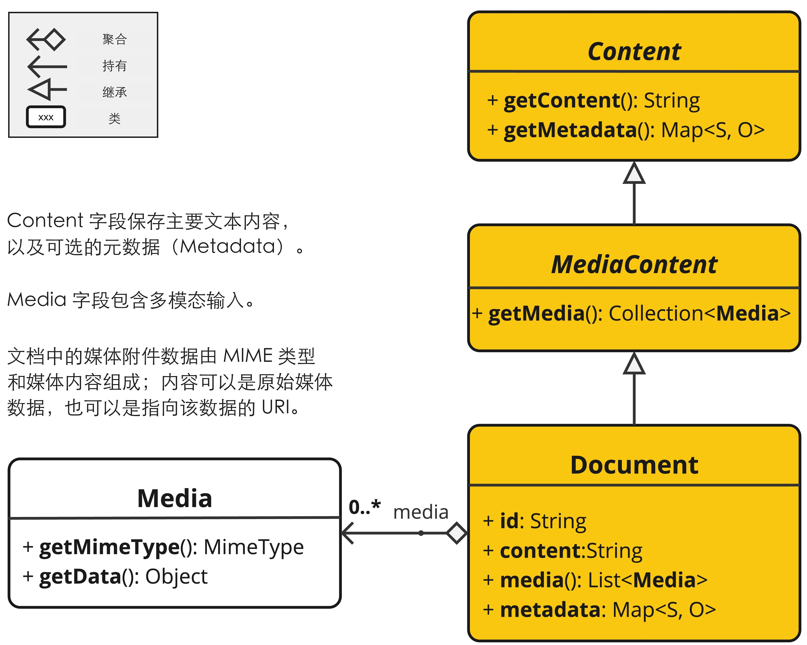
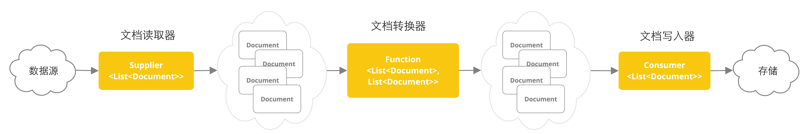
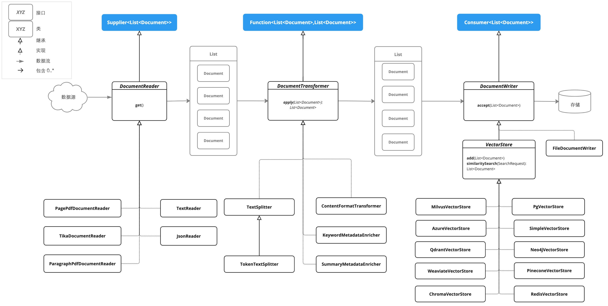

# ETL 管道精翻记录

日期：2026-11-01。来源：Spring AI 2.0.2 参考文档。使用项目 `.baoyu-skills/baoyu-translate/EXTEND.md`：简体中文、精翻、技术读者、简明技术文档风格。

- [英文正文](../spring-ai-etl-pipeline.md) · [来源 HTML](source-article.html) · [来源清单](source-manifest.json)
- [站点正文](../../src/content/docs/frameworks/spring-ai/rag/document-ingestion.mdx) · [定稿](translation.md)
- [分析](01-analysis.md) → [翻译上下文](02-prompt.md) → [初稿](03-draft.md) → [审校](04-critique.md) → [修订](05-revision.md) → [定稿](translation.md)

## 阅读与范围

导航：开发框架 → Spring AI → RAG，接在 MCP 后面。先用 RAG 建立查询链路的认识，再用 ETL 准备资料；实践时先入库，再执行检索和生成。完整参考内容保留，正文以阅读路线和选型表区分重点与按需查阅内容。

本篇覆盖 Document、三类函数式 ETL 接口，JSON、纯文本、HTML、Markdown、两种 PDF 与 Tika 读取器，Token 切分、内容格式、关键词/摘要增强，以及文件和向量存储写入。读取器和参数参考未删减；新增说明区分模型调用、文本写出和向量入库。

## 审校与代码

[审校记录](04-critique.md)列出正文校正；[代码对照](code-fidelity.json)逐段记录源代码、目标代码的编号与哈希。41 段代码中，32 段除空白外一致；8 段修正旧 API、错误的 this 字段引用、重复局部变量和未完成的占位声明；1 段只有 HTML 空元素的自闭合格式变化。正文额外校正 JSON 完整载入树、Markdown 文本提取、Token 阈值/尾块，以及 JVM 默认字符集等说明。

[API 源码清单](api/manifest.json)保留 v2.0.2 标签下的源路径、SHA-256 和原许可证；[静态断言](api-contract-checks.json)包含 31 项检查。

## 覆盖与验证

- [覆盖记录](coverage-audit.json)：83 个源小节、41 段代码、3 张图片全部保留，原英文锚点顺序一致。
- [页面检查](page-validation.json)：1440px 桌面与 390px 手机通过，无横向溢出、脚本错误或 Markdown 标记残留。
- [外链检查](external-links.json)：两篇共 9 个去重页面及来源锚点通过；站内目标与锚点共 118 个通过。
- [执行记录](validation.jsonl)：独立目录 `npm run check` 为 0 错误、0 警告、0 提示；`npm run build` 成功生成 141 页。
- 修订、定稿和站点正文逐字一致。独立验证基线为 `b022be4`，仅叠加本轮两篇正文、图片与导航；并发目录清理和侧栏定制不在此次构建结论范围内。

Java 代码仅与同版本源码静态核对，未编译或调用真实模型。没有执行 Embedding、向量入库或端到端问答，翻译完成不代表学习实践验收完成。

## 图片

[图片清单](image-manifest.json)记录来源、尺寸和 SHA-256。英文 JPG 原图留存；页面使用中文 PNG，尺寸、布局、配色、连线和 Java API 标识符保留。仅在说明文字和图例区域覆盖中文，区域外像素逐一对比无变化；PNG 无损保存，避免二次 JPEG 压缩影响整张图。

- ：说明段落和聚合、持有、继承、类图例汉化，类名、方法名和字段名保留英文。
- ：数据源、文档读取器、文档转换器、文档写入器、存储汉化，函数式接口和 Document 标识符保留英文。
- ：接口、类、继承、实现、数据流与包含关系图例，以及数据源、存储标签汉化，API 标识符保留英文。

旧 Document 图的 getContent()、媒体列表与继承关系不对应当前 2.0.2 实现，正文仍明确以 getText()、单个 Media 与 text/media 二选一为准。汉化不改变原图表达的旧版 API。

[复现脚本](localize-images.py)使用 Pillow 和 macOS 黑体简体字库；[替换清单与像素检查](2026-11-01-image-localization.json)记录全部 20 处替换区域与输出哈希。

## 2026-11-01 站内引用优化

优先使用知识库中主题和范围对应的说明，并核对页面实际生成的锚点。两篇合计替换 3 处外链，补充 4 处站内入口；代码、109 个原始锚点和图片保持不变，修订、定稿与站点正文同步。

RAG 使用本地概念页、ChatClient 提示词模板、PromptTemplate 与 Advisor 处理链；ETL 使用本地 Embedding、分块策略与 Chroma 概念参考。Chroma 页的 Python 示例与本篇 Spring AI Java 用法明确区分。

模块化 RAG 论文、jinfer 重排序、Tika 完整格式列表、Spring AI 完整向量存储列表没有同等覆盖的本地页面，保留外链；两篇文末来源链接也保留用于溯源。具体匹配理由和未替换原因见[链接核验记录](2026-11-01-internal-links.json)。原 external-links.json 为译文初版的来源外链核验，继续留存。

本轮 `npm run check` 为 0 错误、0 警告、0 提示；当前工作区 `npm run build` 成功生成 85 页。桌面与手机共 4 次页面检查通过，124 个站内目标及锚点均可访问。当前页面数与初版不同，源于另一次已经提交的空白文档清理；本轮未删除页面或改动导航。

## 2026-11-01 图片汉化验证

`npm run check`：0 错误、0 警告、0 提示；`npm run build`：85 页构建成功。桌面（1440 px）和手机（390 px）均通过，3 张图片及原尺寸链接可访问，无横向溢出。正文仅替换 6 处图片地址，41 个代码块与全部锚点保持不变。像素对比确认 20 处文字区域外完全保留，3 个英文原图哈希与原清单相同。

## 向量存储站内入口补齐

2026-11-01 向量存储总览翻译完成后，文末 VectorStore 的实现清单引用已改到站内完整列表。原始来源快照和先前核验记录保留，本次仅改1处链接；正文、定稿、修订及覆盖哈希同步。详见[链接记录](2026-11-01-vector-store-link.json)。

## 2026-11-01 引用范围收敛到 Spring AI 模块

按本次要求，正文的站内文档引用仅使用 `/frameworks/spring-ai/` 下的页面或本篇锚点。此前的通用分块与 Python Chroma 引用已由本篇 TokenTextSplitter 参数/注意事项、Spring AI 向量存储总览和 PGvector 接入替代；前面的跨模块引用记录仅保留作历史。RAG 补齐 ChatClient、VectorStore、SearchRequest、元数据过滤与评估测试入口，ETL 补齐聊天模型与 PromptTemplate 入口。

没有等价 Spring AI 笔记的模块化 RAG 论文、jinfer 重排序、Tika 完整格式表继续保留外链；两篇文末来源链接保留用于溯源。本轮没有不确定的站内替换。具体变更和保留原因见[引用范围记录](2026-11-01-spring-ai-only-links.json)。

两篇合计 62 个代码块、109 个原始锚点和 3 个图片组保持不变；站点、定稿与修订逐字一致。当前工作区类型检查 0 错误、0 警告、0 提示，构建成功生成 92 页；桌面与手机共 4 次检查通过，132 个站内页面、锚点及图片目标有效，无页面横向溢出。页面详情见 [本轮检查](2026-11-01-spring-ai-only-page-validation.json)。

## 2026-11-01 RAG 全目录引用复核

本轮按“站内文档只引用 Spring AI 模块”复查整个 RAG 目录。当前页面符合标准，复核后保留正文，代码、原始锚点、图片和已有外链保持不变。历史记录中的模块外引用方案已由本次规则替代，完整逐页变更、保留外链原因与验证结果见 [RAG 全目录记录](../spring-ai-rag-reference-audit/README.md)。

当前工作区类型检查 0 错误、0 警告、0 提示；构建通过（92 页）。8 篇桌面与手机共 16 次检查通过，245 个站内页面、锚点与静态资源目标有效，正文的模块外站内文档引用为 0。Java 示例未编译或执行，未连接真实模型、数据库或云服务。
